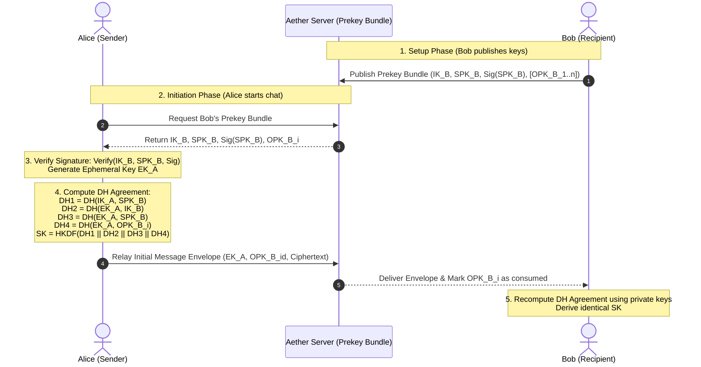
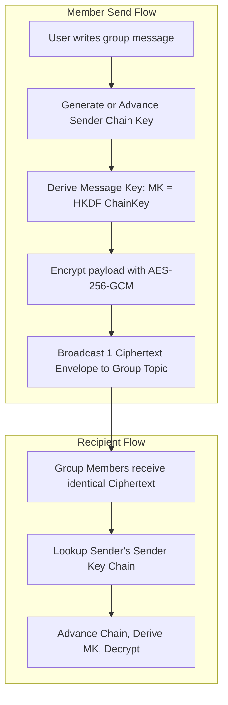

# AetherChat End-to-End Encryption (E2EE) Architecture Proposal

> **Document Version:** 1.0.0  
> **Status:** Proposal / Technical Specification  
> **Target Standard:** Signal Protocol (X3DH + Double Ratchet)  
> **Classification:** Cryptographic & Security Architecture

---

## 1. Executive Summary

AetherChat currently employs a **transport-encrypted, server-relayed architecture**:
- All communications are encrypted in transit via **TLS 1.3**.
- Access control at the database layer is governed by PostgreSQL **Row Level Security (RLS)**.
- Messages and media are delivered through an ephemeral store-and-forward queue and auto-purged from server tables upon client delivery acknowledgement (ACK).
- Local messages are cached on-device in **IndexedDB** (`idb`).

While this model enforces strict isolation between users at the API and database levels, it relies on trust in the server infrastructure. This document specifies the comprehensive blueprint for transitioning AetherChat to **true End-to-End Encryption (E2EE)** using the **Signal Protocol**, guaranteeing forward secrecy, break-in recovery, and zero server knowledge of message plaintext and media contents.

---

## 2. Cryptographic Primitives

The cryptographic suite selected for AetherChat E2EE adheres to industry standards (Signal Protocol / RFC 7748 / RFC 8439):

| Component | Primitive | Specification | Purpose |
| :--- | :--- | :--- | :--- |
| **Identity Keys (IK)** | **Ed25519** | RFC 8032 | Long-term digital signatures, out-of-band verification |
| **Key Agreement (DH)** | **X25519 (Curve25519)** | RFC 7748 | Ephemeral and signed Diffie-Hellman exchanges |
| **Key Derivation** | **HKDF-SHA256** | RFC 5869 | Deriving root, chain, and message encryption keys |
| **Payload Encryption** | **AES-256-GCM** / **ChaCha20-Poly1305** | RFC 8439 | Authenticated Encryption with Associated Data (AEAD) |
| **Fingerprint Generation** | **SHA-512** | FIPS 180-4 | 60-digit safety numbers and QR code payloads |
| **Backup Key Derivation**| **Argon2id** | RFC 9106 | Password-based key derivation for local backups |

---

## 3. Asynchronous Key Agreement: Extended Triple Diffie-Hellman (X3DH)

To establish an initial shared secret when the recipient is offline, AetherChat implements the **Extended Triple Diffie-Hellman (X3DH)** protocol.



### 3.1 Prekey Rotation Policies
- **Signed Prekeys (SPK):** Rotated automatically by the client every 7 days. Old keys are retained for a 14-day grace period to decrypt in-flight messages.
- **One-Time Prekeys (OPK):** Clients maintain a pool of 100 one-time prekeys on the server. When the pool drops below 25, the client generates and uploads a new batch.

---

## 4. Continuous Ratchet: The Double Ratchet Algorithm

Once the shared master key $SK$ is established via X3DH, active communication transitions immediately to the **Double Ratchet**:

1. **Symmetric-Key KDF Ratchet:** Each sent or received message advances a symmetric KDF chain, producing a unique message key ($MK$) and next chain key ($CK_{i+1}$). Even if an individual message key is compromised, prior messages cannot be decrypted (**Forward Secrecy**).
2. **Diffie-Hellman Ratchet:** With every round-trip conversational exchange (message and subsequent reply), a new ephemeral Diffie-Hellman key pair is generated and exchanged. This ensures that even if an attacker gains complete memory access to a device's current state, future messages will automatically become unreadable as soon as the next ratchet step completes (**Break-in Recovery / Self-Healing**).

---

## 5. Group Messaging: Sender Keys Protocol

Pairwise Double Ratchet scaling degrades in large groups ($O(N^2)$ message encryptions per send). AetherChat adopts the **Sender Keys** protocol for multi-party conversations:



### 5.1 Sender Key Distribution & Rotation
- When a user joins or initiates a group, they generate a **Sender Key** (comprising a 32-byte Chain Key and a Signature Key) and transmit it to all group members via their existing **1:1 pairwise E2EE sessions**.
- **Re-keying Trigger (Forward Secrecy upon Member Ejection):** When an admin removes a member or a member leaves the group, all remaining members immediately invalidate their Sender Keys and distribute fresh Sender Keys across the remaining group members.

---

## 6. Multi-Device Enrollment & Identity Management

AetherChat supports seamless multi-device usage without compromising end-to-end security:

1. **Per-Device Cryptographic Identities:** Each device (e.g., Android Phone, Web Desktop) has its own independent `IdentityKey`, `SignedPrekey`, and `DoubleRatchet` state.
2. **Device Pairing via Authenticated Handshake:**
   - The primary device displays an ephemeral QR code encoding `(SessionID, EphemeralPubKey, Nonce)`.
   - The secondary device scans the QR code and opens an encrypted TLS connection.
   - The primary device signs the secondary device's `DeviceIdentityKey` and uploads the device link to the server.
3. **Multi-Recipient Envelope Dispatch (Fan-out):**
   - Outgoing messages are encrypted separately for **all enrolled devices** of each recipient, plus the sender's own companion devices for cross-device synchronization.

---

## 7. Out-of-Band Identity Verification (Safety Numbers)

To guard against active Man-in-the-Middle (MITM) attacks by a compromised server, users can verify identities using **Safety Numbers**:

- **Generation:**
  $$\text{SafetyNumber} = \text{Format60}(\text{SHA-512}(\text{Sort}(\text{IK}_A) \mathbin{\Vert} \text{Sort}(\text{IK}_B)))$$
- **User Interface:** Displayed as both a formatted 60-digit number (12 blocks of 5 digits) and a scannable QR code.
- **Key Change Alerts:** If a contact's `IdentityKey` changes (e.g., app re-install without backup restoration), the UI displays a prominent warning:
  > *"Safety Number Changed: John's security credentials have updated. Tap to verify."*
  Messages sent after the change require explicit acknowledgment by the user.

---

## 8. Encrypted Local Backups & Key Recovery

Because the server holds zero plaintext keys or messages, client device loss would result in permanent data loss without an encrypted backup mechanism:

1. **Client-Side Symmetric Encryption:**
   - The user selects a 12-to-24 word recovery mnemonic (BIP-39 compliant) or a high-entropy passphrase.
   - The key is derived using **Argon2id** ($\text{memory}=64\text{MB}, \text{iterations}=3, \text{parallelism}=4$).
2. **Encrypted Blob Storage:**
   - The local IndexedDB database and media files are bundled, compressed, and encrypted using **AES-256-GCM**.
   - The encrypted blob is uploaded to Supabase Storage in an isolated `user-vault-backups` bucket.
   - The server only holds an opaque encrypted payload with no capability to inspect or recover the contents without the user's secret mnemonic.

---

## 9. Required Database Schema Additions

To support this E2EE architecture, the PostgreSQL schema will be extended with the following tables:

```sql
-- Enrolled Devices per User
CREATE TABLE public.user_devices (
    id UUID PRIMARY KEY DEFAULT gen_random_uuid(),
    user_id UUID NOT NULL REFERENCES auth.users(id) ON DELETE CASCADE,
    device_id INT NOT NULL,
    identity_key TEXT NOT NULL, -- Base64 encoded Ed25519 public key
    registration_id INT NOT NULL,
    created_at TIMESTAMPTZ NOT NULL DEFAULT now(),
    last_active_at TIMESTAMPTZ NOT NULL DEFAULT now(),
    UNIQUE (user_id, device_id)
);

-- Signed Prekeys per Device
CREATE TABLE public.user_signed_prekeys (
    id UUID PRIMARY KEY DEFAULT gen_random_uuid(),
    user_id UUID NOT NULL REFERENCES auth.users(id) ON DELETE CASCADE,
    device_id INT NOT NULL,
    key_id INT NOT NULL,
    public_key TEXT NOT NULL, -- Base64 encoded X25519 public key
    signature TEXT NOT NULL,  -- Ed25519 signature by IdentityKey
    created_at TIMESTAMPTZ NOT NULL DEFAULT now(),
    UNIQUE (user_id, device_id, key_id)
);

-- One-Time Prekeys Pool
CREATE TABLE public.user_one_time_prekeys (
    id UUID PRIMARY KEY DEFAULT gen_random_uuid(),
    user_id UUID NOT NULL REFERENCES auth.users(id) ON DELETE CASCADE,
    device_id INT NOT NULL,
    key_id INT NOT NULL,
    public_key TEXT NOT NULL,
    is_consumed BOOLEAN NOT NULL DEFAULT FALSE,
    created_at TIMESTAMPTZ NOT NULL DEFAULT now(),
    consumed_at TIMESTAMPTZ,
    UNIQUE (user_id, device_id, key_id)
);

-- E2EE Message Envelopes (replacing plaintext messages content)
CREATE TABLE public.encrypted_envelopes (
    id UUID PRIMARY KEY DEFAULT gen_random_uuid(),
    conversation_id UUID NOT NULL REFERENCES public.conversations(id) ON DELETE CASCADE,
    sender_id UUID NOT NULL REFERENCES auth.users(id),
    sender_device_id INT NOT NULL,
    recipient_id UUID NOT NULL REFERENCES auth.users(id),
    recipient_device_id INT NOT NULL,
    message_type INT NOT NULL, -- 1: PreKeyWhisperMessage, 2: WhisperMessage
    ciphertext BYTEA NOT NULL,
    created_at TIMESTAMPTZ NOT NULL DEFAULT now()
);
```

---

## 10. Phased Implementation Roadmap

1. **Phase 1: Cryptographic Engine Integration (`@signalapp/libsignal-client` / WebCrypto)**
   - Initialize local key-store inside IndexedDB (`idb`).
   - Implement prekey bundle generator and registration API.
2. **Phase 2: 1:1 Direct Chat E2EE**
   - Implement X3DH key agreement and Double Ratchet message envelope dispatch.
   - Migrate `messages` payload to binary ciphertexts.
3. **Phase 3: Multi-Device Pairing & Safety Numbers**
   - Build QR code device enrollment flow.
   - Implement Safety Number UI and fingerprint comparison sheet.
4. **Phase 4: Group Sender Keys & Encrypted Cloud Backups**
   - Implement Sender Keys protocol for direct group scaling.
   - Implement Argon2id client-side encrypted backup export and import.
